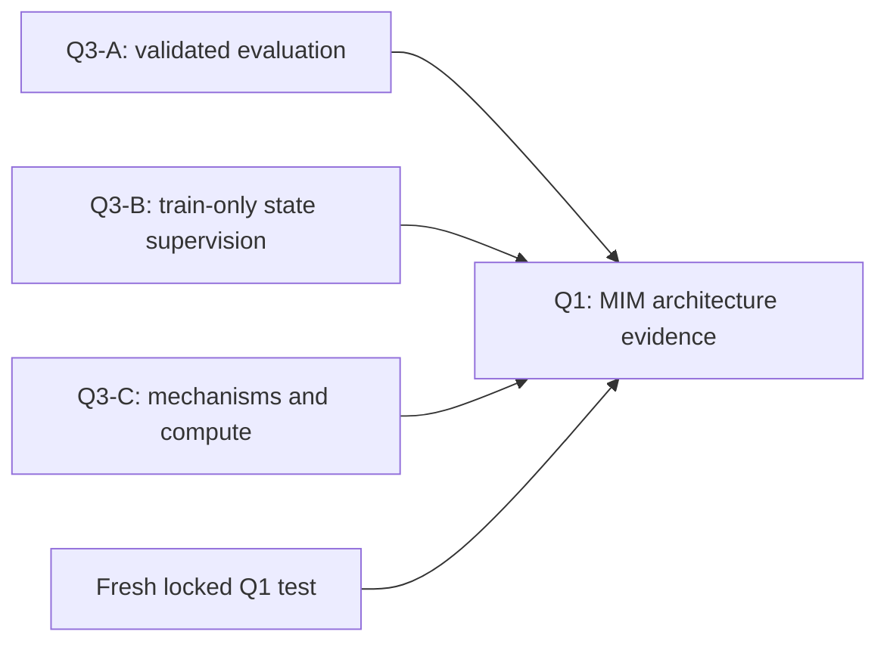

# Q3-A — Đề cương điều chỉnh để chuẩn bị nộp bài

**Bản định hướng hiện hành, revision 2 — 25/11/2026.** Research planning, chưa đăng
ký trước, chưa có dữ liệu/nhãn/kết quả mới. Bản này thay thế phạm vi và core matrix
Q3-A trong kế hoạch đầu; các hồ sơ trước được giữ để truy vết. Không có cơ sở định
lượng xác suất chấp nhận. Mục đích sửa là tăng tính rõ ràng, khả thi và sức thuyết
phục của bằng chứng trong phần chúng ta kiểm soát được.

## 1. Tên, câu hỏi và vị trí trong chương trình bốn bài

**English working title:**
**Evaluating Temporal State Consistency in Story Continuation: A Controlled Study
of Updates, Invariance, and Omission**

**Tên tiếng Việt:** Đánh giá tính nhất quán trạng thái theo thời gian trong viết
tiếp truyện: nghiên cứu có đối chứng về cập nhật, bất biến và bỏ sót hệ quả.

**Câu hỏi chính:** Với cùng thông tin và cùng mô hình chấm, biểu diễn mệnh đề theo
thế giới/thời điểm có giúp bộ chấm nhận ra thành công ngữ nghĩa của đoạn tiếp nối
chính xác hơn một checklist phẳng mạnh, trên truyện nguồn chưa dùng để chọn
protocol hay không?

Câu hỏi chẩn đoán: bộ chấm phân biệt được (a) đổi trạng thái hợp lệ, (b) dùng lại
trạng thái đã hết hiệu lực, (c) đổi sai dữ kiện phải giữ, và (d) bỏ qua hệ quả bắt
buộc đến mức nào? Phần (d) là thiếu hoàn thành nhiệm vụ, **không tự là mâu thuẫn**.
Không kết tội một contradiction detector vì nó làm đúng mục tiêu hẹp của nó;
kiểm tra xem dùng detector ấy làm thước đo thành công toàn tác vụ có đủ không.

Ba bài Q3 vẫn phục vụ Q1 và vẫn cần đóng góp độc lập:

| Bài | Đóng góp độc lập | Sản phẩm chuyển sang Q1 | Ranh giới |
|---|---|---|---|
| Q3-A | Kiểm chứng giá trị và giới hạn của phép đánh giá trạng thái thời gian trên văn bản mở. | Task contract, rubric, bộ chấm đã kiểm chứng, mã chấm và protocol test. | Không cần MIM thắng; không nhận phát minh checklist hoặc counterfactual invariance. |
| Q3-B | Kiểm định tác dụng/chi phí của state supervision chỉ lúc train. | Schema nhãn, công cụ gán nhãn và một ablation/candidate objective có căn cứ. | Q1 phải tách lợi ích kiến trúc khỏi lợi ích nhãn; primary intrinsic arm không nhận gold state ở inference. |
| Q3-C | Cơ chế và hiệu quả N/S/M, learned-pair và các đối chứng hồi quy. | Lựa chọn có căn cứ, phạm vi thất bại, resource matching và giả thuyết cơ chế. | Gộp vào Q1 nếu chỉ còn bảng ablation của Q1. |
| Q1 | Giá trị khái quát của sai phân tường minh qua MIM-N→MIM-S. | Bài kiến trúc chính với bằng chứng mới ngoài kết quả thành phần. | Dùng test mới/khóa trước; không trình bày lại bảng đã công bố như kết quả mới. |

Q1 không cần chờ ba bài Q3 được nhận/xuất bản. Các sản phẩm đủ tin cậy có thể dùng
ngay, kèm citation/version và công khai phần dùng chung. Không chia cùng một
claim/bảng kết quả thành nhiều bài để đạt số lượng.

## 2. Sửa gì để giảm nguy cơ bị từ chối ngay từ biên tập?

| Kế hoạch trước | Quyết định hiện hành | Lý do |
|---|---|---|
| Benchmark rộng về thời gian, ghi đè, hai thế giới, self-event. | Một nghiên cứu kiểm chứng phép đánh giá có đối chứng; dataset là phương tiện. | Có câu hỏi và đối tượng so sánh rõ, tránh chỉ đóng góp dữ liệu/template. |
| Train 4 kiến trúc×3 seed×10M targets làm core. | Core dùng inference từ model mở có khả năng viết; không bắt buộc train mới. | Giảm writing floor, thời gian và phụ thuộc MIM thắng; train kiến trúc thuộc Q1/C. |
| Primary là điểm thành công của generator. | Primary là độ đúng của evaluator so với nhãn độc lập; generator success là đối tượng được chấm. | Không lẫn chất lượng thước đo với chất lượng hệ được đo. |
| So với chấm chung chung. | Checklist mạnh cùng thông tin là đối chứng chính. | CheckEval đã có; không chọn strawman để tạo gain. |
| Nhiều họ quy tắc và self-event đều bắt buộc ngay. | Core ba bối cảnh cùng một loại trigger thời điểm; self-event là extension có gate. | Giảm số yếu tố thay cùng lúc; không trì hoãn bài vì quá nhiều nhánh. |

Đóng góp dự kiến: một khảo sát thực nghiệm có kiểm soát về lỗi evaluator theo
state/time/world, cùng protocol tái lập được. Không đặt claim “metric đầu tiên”
hay “hơn SOTA” trước kết quả. Kết quả null vẫn có thể hữu ích nếu cho biết cấu trúc
phức tạp không hơn checklist đơn giản và có bằng chứng đủ chính xác; null không
tự bảo đảm đủ một bài độc lập.

## 3. Tài liệu gần và cách tránh lặp lại

[OpenMEVA](https://aclanthology.org/2021.acl-long.500/) đã kiểm chứng metric truyện
bằng tương quan người, perturbation và generalization. [CheckEval, EMNLP 2025](https://aclanthology.org/2025.emnlp-main.796/)
đã phân rã tiêu chí thành câu hỏi Boolean để tăng độ tin cậy của LLM judge.
Không nhận hai ý tưởng này là mới. Trong revision này đã tải PDF CheckEval 28
trang, đọc Method §3 và phần thiết lập liên quan, chưa tái lập code; SHA-256:
`e56135b11cf57ae4bdbab99257ac5e2d70266a20c2060f9d40c014d2f8b5f1f9`.

[FactTrack](https://aclanthology.org/2025.naacl-long.144/) đã có hiệu lực theo thời
gian; [PASTA](https://aclanthology.org/2023.tacl-1.73/) đã có state perturbation và
chỉ số ALL; [ConStory-Bench](https://aclanthology.org/2026.findings-acl.410/) đã đánh
giá nhất quán truyện tự sinh. Vì vậy đóng góp còn phải được chứng minh bằng lỗi
và đối chứng cụ thể của task này, cùng transfer sang đầu ra tự sinh chưa sửa.

Survey mới được sàng lọc qua [kho trường của tác giả](https://cau.scholarworks.kr/item/e59ea26a-67fa-48d8-966b-525e78de352a),
*Narrative Consistency in Large Language Model-Generated Stories: A Survey*,
IEEE Access 2026, DOI 10.1109/ACCESS.2026.3710595, cũng nêu nhu cầu evaluation về
omission và task-conditioned verification. Mới đọc metadata/abstract ở lượt này;
không dùng survey làm bằng chứng phần thực nghiệm của chúng ta đã mới.

Lượt tra này bổ sung web query về narrative consistency/omission/completeness,
CheckEval và bài J.UCS liên quan; không chạy thêm Undermind, không tuyên bố survey
toàn diện. 17 PDF trong sổ nguồn trước vẫn là tập lịch sử; CheckEval là nguồn bổ
sung thứ 18 đã truy xuất qua hai lượt, không thay manifest lịch sử.

## 4. Task contract và phạm vi vừa sức

Tiếp tục sinh tự hồi quy **3–5 câu**, không biến bài thành dự đoán nhãn. Văn bản
là tiếng Anh trong core; không suy ra năng lực tiếng Việt. Prefix xác định:
người/vị trí giữ vật, các cập nhật trước quyết định, điều kiện cần, giờ áp dụng
và giả định mọi nhân vật tuân thủ. Trạng thái ghi \(s^w_{t,k}\), với world w,
time t, micro-event order k. Mệnh đề ghi đủ world/time/attribute/value.

Ba bối cảnh dự kiến: quyền tiếp cận tủ/phòng; giao kiện hàng trước giờ bàn giao;
và chuẩn bị thiết bị trước giờ vận hành. Dùng vật giả định vô hại, không đặt claim
y khoa/an toàn công nghiệp. Chúng dùng cùng loại luật kiểm tra một lần tại giờ
đã nêu; là **ba bối cảnh của cùng schema**, chưa phải ba cơ chế logic độc lập.
Holdout paraphrase/author phải khai báo đúng mức khái quát hóa.

Giữ quy tắc ở hồ sơ cũ: không suy từ nghĩa vụ sang hành động nếu thiếu compliance;
không suy chắc mở lúc điện về muộn; possession không phải ownership; tách actual
với hypothetical. Đầu truyện chỉ đổi một tiền đề; có effective crossing và no-op
ở cùng phía ngưỡng. Có nhiều đáp án sáng tác đúng; không ép cùng nơi cất vật.

## 5. Thiết kế bằng chứng: hai tập, hai vai trò

**Tập lỗi có kiểm soát** dùng để chẩn đoán: từ anchor hợp lệ tạo bản paraphrase
giữ nghĩa, cập nhật hợp lệ, stale-state, sai invariant, trộn thế giới và omission.
Mỗi phép sửa kiểm tra lại không vô tình tạo lỗi thứ hai. Người đọc xác nhận nhãn;
nhãn từ code sửa không tự là gold ngữ nghĩa. Split theo anchor gốc, không rải các
bản sửa qua development/test. Kết quả này không chứng minh evaluator giỏi trên
lỗi tự nhiên.

**Tập đầu ra sinh nguyên trạng** là nơi so sánh chính: hai generator mở, không sửa
output; hai người đọc độc lập chấm semantic success và lỗi theo loại. Giữ mọi
đầu ra, kể cả lỗi format, generic, mơ hồ và hỏng ngôn ngữ. Không chỉ lấy output
evaluator đề xuất chấm sai. Nhãn human không do judge sinh giả.

Số lượng lập kế hoạch, **chưa có dữ liệu**:

- 24 source development để sửa ngữ nghĩa/rubric; 24 source validation để chọn
  prompt, sample size và feasibility, không chọn bằng test.
- Test dự kiến 96 source, ít nhất 48 do người viết thành truyện naturalistic;
  số còn lại có thể là controlled template. Hai premise/source×hai generator
  ⇒ 384 output nếu dùng đúng quy mô này. Human-written naturalistic không đồng
  nghĩa truyện văn học ngoài đời hay dữ liệu không có kiểm soát.
- Tách nguồn, tác giả/paraphrase và anchor; cân bằng effective/no-op, chia depth
  thấp/cao theo block. Depth/recency là secondary, không tuyên bố đủ power cho
  mọi tương tác nhiều chiều.
- Cỡ test cuối chọn bằng mô phỏng validation, precision và ngân sách trước khóa,
  cap đề xuất 192 source. 96 không phải chứng minh đã đủ power. Nếu không đủ khả
  năng gán nhãn, thu hẹp claim hoặc hoãn; không mở test rồi tăng mẫu vì p-value.

Self-event vẫn phục vụ Q1: là extension sau khi core ổn, không phải điều kiện
chọn output core. Giữ nguyên đoạn đầu/token IDs, ghi trạng thái thực mô hình tự
chọn và chấm tiếp nối theo lịch sử đó. Nếu chưa đủ nhãn thì công bố là kế hoạch
cho Q1, không viết như một đóng góp Q3-A đã làm.

## 6. Đối chứng bộ chấm và thông tin được phép xem

R là obligation manifest do task/oracle xác định từ prefix, không từ output cần
chấm; thay đổi trạng thái do output sáng tác phải được đọc riêng. Gold human labels
không được cung cấp cho evaluator. Generator luôn chỉ nhận prefix và yêu cầu.

| Evaluator dự kiến | Input và vai trò | Giới hạn diễn giải |
|---|---|---|
| E0 direct task-success judge | x,y; biết yêu cầu, trả semantic success và evidence. | So với hệ có R là so pipeline thêm cấu trúc/thông tin, không chỉ prompt format. |
| E1 strong flat checklist | x,y,R; câu Boolean về yêu cầu, contradiction và omission; yêu cầu evidence span. Dựa trên CheckEval, ghi rõ adaptation. | Đối chứng chính, không cố ý bỏ tiêu chí thời gian/coverage để làm yếu. |
| E2 world/time grouped checklist | Cùng x,y,R, cùng backbone và yêu cầu evidence như E1; nhóm và căn chỉnh mệnh đề theo world/time. | **E2−E1 là contrast chính.** Cả hai có cùng nội dung mệnh đề; không cho E2 thêm đáp án/metadata mà E1 không có. |
| Contradiction-only/overlap diagnostics | Chỉ tiêu hẹp, output và input đúng theo định nghĩa từng metric. | Không gọi omission là lỗi contradiction detector; kiểm tra tính đủ khi dùng như overall-success proxy. |

Prompts, R, parser và budget đóng băng trước test. Báo prompt/output tokens, số
lượt gọi, độ trễ, VRAM và lỗi JSON/truncation. Nếu E2 dùng thêm compute thì ghi
đúng; cùng max tokens không chứng minh cùng compute thực. Judge abstain/parse
failure không được loại khỏi denominator. Không dùng cấu trúc event gold để chấm
thẳng JSON rồi gọi đó là giải quyết free prose.

Ngân sách prompt selection dự kiến tối đa bốn biến thể development cho mỗi E1/E2,
cùng tập nguồn và cùng trần token/call; chọn luật trên validation rồi khóa. Không
chạy nhiều vòng chỉ cho E2. Gold labels dạng thành công/thất bại/mơ hồ được giữ
riêng: hai người phân xử mơ hồ trước khi mở kết quả evaluator. Nếu còn unresolved,
báo số lượng và sensitivity bounds khi coi chúng lần lượt là 0/1; không lặng lẽ
loại chúng rồi gọi primary là toàn bộ tập test. Nếu không xác định được gold đủ
tin cậy, không phát hành kết luận primary.

Chọn một backbone judge chính bằng feasibility validation và luật đã định trước;
một họ model khác là replication. Cả E1/E2 luôn chạy cùng backbone trong mỗi
contrast. Có thể xét [Qwen3-1.7B](https://huggingface.co/Qwen/Qwen3-1.7B) và
[SmolLM2-1.7B-Instruct](https://huggingface.co/HuggingFaceTB/SmolLM2-1.7B-Instruct),
đều có official card ghi Apache-2.0. Đây là **ứng viên**, chưa tải/chạy trong lượt
này. “1.7B” là tên/cỡ danh nghĩa; ghi actual parameter count từ model tải thực,
không dùng số danh nghĩa làm số đo. Kiểm tra self-preference bằng breakdown theo
họ generator; nếu dùng cùng hai họ làm generator/judge, đó không phải xác nhận
độc lập hoàn toàn. Không tự mở rộng claim sang frontier LLMs.

## 7. Primary outcome và phân tích đã chọn cho revision

Human gold y=1 khi đủ mệnh đề bắt buộc và không tự mâu thuẫn trong đúng world/time;
format 3–5 câu và fluency được báo riêng. Primary của nghiên cứu evaluator là:

\[
\Delta_{BA}=BA(E2)-BA(E1),\qquad
BA(E)=\tfrac12\left(\frac{TP}{n_{y=1}}+\frac{TN}{n_{y=0}}\right).
\]

Đó là **balanced accuracy**: trung bình tỷ lệ nhận đúng output thành công và tỷ
lệ nhận đúng output thất bại, tránh lớp đông áp đảo. Khi evaluator abstain/parse
fail, mẫu vẫn nằm trong lớp gold tương ứng nhưng không được tính TP/TN. Nếu thiếu
một lớp gold, BA không xác định: báo N/A và lỗi thiết kế/capability, không tự đặt
100% hoặc tìm thêm output có lợi từ test. Primary trên output sinh nguyên trạng
của locked test; báo riêng hai provenance strata và từng generator, không chỉ
gộp để che một miền thất bại.

Bootstrap **paired theo source**: cùng resample giữ tất cả premise/generator cho
E1 và E2. Báo 95% CI của hiệu số, không so chồng lấp hai CI riêng. Các judge backbone
là phép replication riêng; model/version hoặc decoding replicate không phải
source độc lập. Primary contrast một, những contrast còn lại là secondary và có
kế hoạch điều chỉnh/ghi exploratory phù hợp.

Secondary bắt buộc: false acceptance trên output sai, false rejection trên output
đúng, valid-update false alarm, stale-state/world-mix/omission detection, changed
và invariant riêng, semantic vs format, abstention, agreement trước phân xử và
cost. Contradiction-only và omission phải báo riêng đúng construct. Nếu so thứ
hạng generator, dùng cùng output set và report uncertainty; không suy rank gain
từ vài ví dụ sửa bằng tay. Không tạo một metric cộng nhiều trọng số sau khi xem test.

SESOI đề xuất để chốt sau validation: **5 điểm phần trăm BA**. Đây là ngưỡng
quyết định thực dụng, không phải quy định journal. Gain nhỏ/CI rộng không được
viết thành “vượt trội”. Nếu muốn kết luận tương đương, cần equivalence design
và precision đủ, không suy từ p>0.05. Protocol vẫn draft; preregister sau feasibility
và trước test, công khai mọi thay đổi so revision này.

## 8. Tài nguyên, ngân sách nhãn và scope

Core không bắt buộc một run train mới; matrix 120M targets cũ chuyển thành **extension
cho Q1/C**, không còn điều kiện hoàn tất Q3-A. Có thể dùng output MIM-LM khi thật
sự viết được như một nhóm phụ; bản BPE tham chiếu 2,081,472 tham số không phải
baseline bắt buộc của bài evaluator. Không dùng việc bỏ MIM khỏi core để bỏ mục
tiêu MIM-LLM: bộ chấm được xây để kiểm tra Q1 đáng tin hơn.

Máy là RTX 5050 Laptop, 8.151 MiB theo phép đo trước. Chạy lần lượt từng model,
smoke-test context/VRAM và khả năng judge trước; không hứa 1.7B chắc chắn đủ làm
judge. Nếu writing/judging đều floor thì sửa feasibility hoặc dừng; không mặc định
mua API/cloud. Colab tokens/s và CU/h vẫn chưa đo.

384 core outputs×2 readers×2–4 phút = **25,6–51,2 giờ-người**, chưa gồm controlled
edits, viết truyện, training rubric và phân xử. Đây là giả định chi phí, chưa đo.
Controlled set có cap riêng; dự toán mẫu từ thời gian thật trước freeze. Tổng GPU
giờ tính từ generation/judging input-output tokens và latency đo trên máy; không
dùng training tok/s của MIM để dự báo inference của judge khác.

Nếu cả ba E0/E1/E2 chạy một call/output trên hai judge backbone, 384 outputs cần
**2.304 judge calls**, ngoài 384 lần sinh và các lượt dev/controlled. Đây là phép
tính kế hoạch, chưa phải số call đã chạy; full implementation checklist có thể
cần nhiều call hơn. Không suy inference rẻ chỉ từ việc không train.

Khung thực hiện dự kiến **8–12 tuần**, có dự phòng; một tháng đầu chốt feasibility
và Methods chứ không hứa nộp xong. Review journal là thời gian riêng, chưa biết.

## 9. Journal phù hợp và giới hạn bằng chứng hiện tại

**Ứng viên chính: Journal of Universal Computer Science (J.UCS)**, ISSN 0948-6968
online / 0948-695X print. Định vị như empirical evaluation/methodology trong CS.
[Trang chính thức](https://profile.jucs.org/) ngày 25/11/2026 nêu phạm vi CS rộng,
miễn phí cho tác giả/người đọc, single-blind và ít nhất hai editorial-board reviewers.
Đây là bằng chứng scope và chính sách miễn phí chung, không phải acceptance guarantee.
Không suy xác suất nhận riêng từ acceptance rate của journal.

Ví dụ scope: *An Empirical Evaluation of Large Language Models in Static Code
Analysis for PHP Vulnerability Detection*, DOI 10.3897/jucs.134739, có
[accepted manuscript ở trường của tác giả](https://www.cs.kent.ac.uk/people/staff/ba284/home/Papers/JUCS2024-AAM.pdf);
*Enhancing Knowledge Graph Construction with Automated Source Evaluation Using
Large Language Models*, DOI 10.3897/jucs.137103, có bản publisher PDF trong kết quả
tra và là empirical evaluation với human comparison. Chúng chứng minh journal có
bài NLP/evaluation, không chứng minh bài của ta chắc chắn hợp hoặc dễ nhận.

SJR cũ đã ghi Q3 CS miscellaneous/Q4 Theoretical CS; **lần tái tra này SCImago
trả 403**, không coi đã fresh-verified. Trang journal tự hiển thị JCR Q3 Theory &
Methods/Q4 Software Engineering nhưng không thay Clarivate direct verification.
Chi tiết phí phụ, độ dài và template submission chưa truy cập đủ do lib.jucs.org
403. **Trạng thái readiness journal: chưa đủ căn cứ tái xác minh đầy đủ phí/hạng/
độ dài cho lần nộp.** Giữ tuyến 0 VND, kiểm tra lại mọi khoản bắt buộc trước nộp.

JLM không còn là fallback tự động: [scope chính thức](https://jlm.ipipan.waw.pl/index.php/JLM/about)
yêu cầu linguistic insight và loại phát triển LM đơn thuần. Chỉ xét lại nếu kết
quả mang phát hiện ngữ nghĩa học đủ sâu; Q3 Linguistics không tự là Q3 CS. Không
đổi câu chuyện nghiên cứu để lách tài trợ; UEH chưa duyệt tài trợ cho người dùng.

## 10. Bộ bằng chứng tối thiểu và quy tắc quyết định

1. Có task contract không mơ hồ và source/license manifest; shortcut anchors bị
   kiểm tra trên development. R đủ thể hiện hệ quả nhưng không ép chuyện tự do.
2. Có nhãn độc lập của hai người, evidence spans và disagreement trước phân xử;
   rubric không chỉ xác nhận lại cách oracle được viết.
3. E1 đủ mạnh, cùng thông tin với E2; audit prompt/compute và tested parser.
4. Primary chạy trên output nguyên trạng ngoài nguồn chọn cấu hình; controlled
   errors chỉ là diagnostic. Kết luận có CI, scope và negative outcomes.
5. Có ít nhất một phát hiện thực nghiệm không phải tautology “thêm coverage thì
   điểm coverage đổi”, và không chỉ bảng nguồn dữ liệu. Gain có thể không có;
   phát hiện null chỉ đủ bài nếu thật sự giải thích được giới hạn phương pháp.
6. Freeze rubric/evaluator sau Q3-A để phục vụ Q1; Q1 có source test mới, run/test
   registry và disclosure phần dữ liệu/methods đã dùng trong các Q3.

**Gộp/dừng:** evaluator nhỏ không đủ năng lực mà không có phương án trong ngân
sách; nhãn không thể ổn định; kết luận chỉ xuất hiện trên lỗi sửa tay; E2 có lợi
chỉ do được thêm thông tin/compute; hoặc không có insight vượt CheckEval/OpenMEVA/
FactTrack. Không giữ một bài yếu chỉ để đủ ba Q3; phần hữu ích vẫn đưa vào Q1.

## 11. Kế hoạch 30 ngày đầu sau revision

| Tuần | Công việc | Điều kiện hoàn thành |
|---|---|---|
| 1 | Chốt một loại trigger/ba bối cảnh, 12–24 cặp dev, prompts E1/E2 và tiêu chí người đọc. | Không còn gold có hai diễn giải chưa xử lý; baseline không bị làm yếu. |
| 2 | Smoke inference hai model ứng viên, hai người chấm thử; đo thời gian, floor và parser. | Có log VRAM/latency, nhãn thật, danh sách disagreement và quyết định khả thi. |
| 3 | Sửa schema v1, controlled edit audit, source/license split, simulation CI/sample size. | Chốt được budget và sample size trước test; không gọi v0 là benchmark nghiên cứu đã sẵn sàng. |
| 4 | Viết Methods/Related Work và preregistration draft; kiểm tra journal/template. | Protocol/tables skeleton đồng bộ, completion gates rõ; chỉ freeze khi feasibility thật sự đạt. |

Methods có thể viết trước; abstract/conclusion có kết quả chỉ viết sau phân tích.
Thành tích bản thảo có kết quả / nộp / nhận / xuất bản vẫn theo dõi riêng, chưa đạt.
